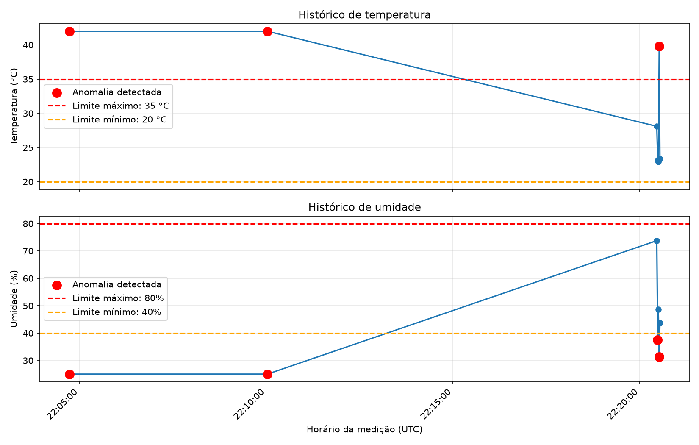

# IoT Agent — Monitoramento Inteligente com AWS e IA

Sistema experimental de monitoramento IoT desenvolvido em Python, com integração ao Amazon S3, detecção automática de anomalias e análise de dados utilizando inteligência artificial local.

O projeto explora a integração entre **desenvolvimento backend, computação em nuvem, análise de dados e modelos de linguagem**, utilizando sensores simulados.

## Visão geral

O IoT Agent permite receber e armazenar medições de temperatura e umidade, identificar valores fora dos limites configurados e gerar análises técnicas com auxílio de um modelo de linguagem.

O objetivo é desenvolver uma arquitetura modular que possa evoluir para o monitoramento de dispositivos IoT reais.

## Tecnologias utilizadas

| Tecnologia | Aplicação |
|---|---|
| Python | Desenvolvimento da aplicação |
| FastAPI | API REST para recebimento de telemetria |
| Amazon S3 | Armazenamento de registros históricos |
| Boto3 | Integração Python com serviços AWS |
| Ollama | Execução local de modelos de IA |
| Qwen3 8B | Interpretação textual de anomalias |
| Matplotlib | Visualização de dados históricos |
| Git e GitHub | Versionamento e documentação |

## Funcionalidades implementadas

- API REST para recebimento de telemetria.
- Simulação de sensores de temperatura e umidade.
- Armazenamento de arquivos JSON no Amazon S3.
- Organização de registros por data e identificadores únicos.
- Recuperação de dados históricos armazenados na nuvem.
- Detecção automática de anomalias baseada em limites configuráveis no código.
- Integração com Qwen3 8B para interpretação de leituras anormais.
- Cálculo de estatísticas históricas.
- Geração de gráficos de temperatura e umidade.
- Identificação visual de medições fora dos limites.

## Arquitetura

```text
Dispositivo IoT simulado
          |
          v
      Python / FastAPI
          |
          v
       Amazon S3
          |
          v
   Consulta de telemetria
          |
          v
   Detector de anomalias
          |
          +---- NORMAL ---> Resultado local
          |
          +---- ALERTA ---> Ollama / Qwen3 8B
                                |
                                v
                         Análise técnica
```

A API e o modelo de inteligência artificial são executados localmente. O Amazon S3 é utilizado para armazenamento dos dados.

O processamento histórico e a análise inteligente ainda são iniciados manualmente.

## Visualização do monitoramento

O sistema gera gráficos históricos de temperatura e umidade, incluindo limites operacionais demonstrativos e destaque visual de anomalias.



## Estrutura do projeto

Os principais módulos estão localizados na pasta `backend/`.

| Arquivo | Responsabilidade |
|---|---|
| `main.py` | API REST de telemetria |
| `enviar_s3.py` | Envio de leituras simuladas ao S3 |
| `consultar_s3.py` | Consulta de uma leitura específica |
| `historico_s3.py` | Recuperação do histórico |
| `detector.py` | Identificação de anomalias |
| `agente_ia.py` | Integração com Qwen3 |
| `monitoramento.py` | Monitoramento integrado |
| `analise_historica.py` | Classificação de registros históricos |
| `estatisticas.py` | Cálculo de estatísticas |
| `graficos.py` | Geração de gráficos |

## Como executar

### Pré-requisitos

- Python 3.12 ou versão compatível.
- Git.
- AWS CLI configurado.
- Bucket Amazon S3 com permissões adequadas.
- Ollama instalado.
- Modelo `qwen3:8b` disponível localmente.

### Instalação

Clone o repositório:

```bash
git clone https://github.com/LuizBarbosa04/projeto-iot-agent.git
cd projeto-iot-agent/backend
```

Crie um ambiente virtual:

```powershell
python -m venv .venv
.\.venv\Scripts\Activate.ps1
```

Instale as dependências:

```powershell
pip install -r requirements.txt
```

Configure um perfil AWS local chamado `scopo-lab`, com acesso ao bucket utilizado pelo projeto. Os scripts atuais utilizam esse perfil e o bucket definidos no código.

Não armazene credenciais AWS diretamente nos arquivos Python.

### Executar a API

```powershell
uvicorn main:app --reload
```

A documentação interativa estará disponível em:

`http://127.0.0.1:8000/docs`

### Executar a análise com IA

Instale o modelo local:

```powershell
ollama pull qwen3:8b
```

Com o Ollama em execução, execute:

```powershell
python monitoramento.py
```

### Consultar o histórico

```powershell
python analise_historica.py
python estatisticas.py
python graficos.py
```

## Limites demonstrativos

| Indicador | Mínimo | Máximo |
|---|---:|---:|
| Temperatura | 20 °C | 35 °C |
| Umidade relativa | 40% | 80% |

Esses limites foram definidos para testes e não representam parâmetros universais de segurança.

## Limitações atuais

- Os dispositivos são simulados.
- O monitoramento ainda não é contínuo.
- O processamento histórico carrega os registros em memória.
- A integração com Qwen3 depende do Ollama local.
- Não existe autenticação de usuários na API.
- A aplicação ainda não está implantada em infraestrutura cloud.

## Próximas evoluções

- Automatização do monitoramento.
- Suporte a múltiplos dispositivos.
- Relatórios históricos com inteligência artificial.
- Filtros por dispositivo e período.
- Integração com sensores ESP32 reais.
- Banco de dados PostgreSQL.
- Autenticação e controle de acesso.
- Implantação do backend em nuvem.

## Autor

**Luiz Gustavo Freire Barbosa**

Graduando em Ciência da Computação — UNINASSAU Maceió.

[GitHub](https://github.com/LuizBarbosa04)

## Sobre o projeto

Projeto desenvolvido para aprendizado prático e demonstração de competências em desenvolvimento backend, integração com AWS, análise de dados e inteligência artificial aplicada ao monitoramento IoT.