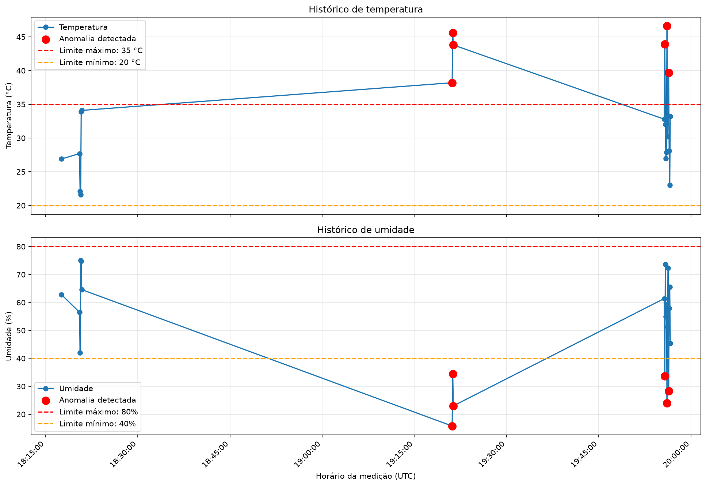

# IoT Agent — Monitoramento Inteligente com AWS e IA Local

Sistema experimental de monitoramento IoT desenvolvido em Python, integrando API REST, armazenamento em nuvem, detecção de anomalias, visualização de dados e inteligência artificial local.

O projeto utiliza sensores simulados para demonstrar um fluxo completo de telemetria, desde a geração dos dados até sua interpretação por um modelo de linguagem.

## Visão geral

O IoT Agent permite:

- Simular dispositivos que enviam temperatura e umidade.
- Receber telemetria por uma API FastAPI.
- Armazenar registros históricos no Amazon S3.
- Consultar e analisar medições.
- Identificar anomalias com regras determinísticas.
- Gerar análises técnicas utilizando Qwen3 8B.
- Visualizar dados em um dashboard Streamlit.
- Atualizar automaticamente o monitoramento.
- Gerar estatísticas, gráficos e relatórios históricos.

O objetivo é demonstrar a integração entre desenvolvimento backend, computação em nuvem, análise de dados e inteligência artificial aplicada a sistemas IoT.

## Tecnologias utilizadas

| Tecnologia | Aplicação |
|---|---|
| Python 3.12 | Linguagem principal |
| FastAPI | API REST |
| Pydantic | Validação de dados |
| Amazon S3 | Armazenamento histórico |
| Boto3 | Integração com AWS |
| Streamlit | Dashboard interativo |
| Pandas | Processamento de dados |
| Altair | Gráficos do dashboard |
| Matplotlib | Gráficos históricos |
| Ollama | Execução local de modelos |
| Qwen3 8B | Análise inteligente de telemetria |
| Pytest | Testes automatizados |
| GitHub Actions | Integração contínua |

## Arquitetura

```text
              SENSOR IoT SIMULADO
                      |
                      | HTTP POST /telemetria
                      v
                 FASTAPI
                      |
                      | JSON
                      v
                  AMAZON S3
                      |
           +----------+-----------+
           |                      |
           v                      v
    CONSULTA HISTÓRICA      DASHBOARD STREAMLIT
           |                      |
           v                      |
    DETECTOR DE ANOMALIAS         |
           |                      |
      +----+----+                 |
      |         |                 |
    NORMAL    ALERTA              |
      |         |                 |
      |         v                 |
      |    OLLAMA / QWEN3 8B <----+
      |         |
      |         v
      |    ANÁLISE TÉCNICA
      |         |
      +---------+
           |
           v
    RELATÓRIOS E ESTATÍSTICAS
```

A API, o simulador, o dashboard e o modelo de IA são executados localmente.

O Amazon S3 é utilizado como serviço de armazenamento em nuvem.

A detecção de anomalias utiliza regras programadas em Python. O modelo de linguagem é responsável pela interpretação textual dos resultados, não pela determinação dos limites.

## Funcionalidades

### 1. Simulação de sensores

O simulador representa um dispositivo denominado `esp32-simulado-01`.

Possui três modos:

| Modo | Comportamento |
|---|---|
| 1 | Gera leituras normais |
| 2 | Gera leituras com anomalias |
| 3 | Alterna aleatoriamente entre os dois tipos |

As leituras são enviadas a cada 5 segundos para a API.

A simulação continua até ser interrompida com `Ctrl+C`.

### 2. API REST

A API FastAPI disponibiliza o recebimento de telemetria por meio de:

`POST /telemetria`

Exemplo de requisição:

```json
{
  "dispositivo": "esp32-simulado-01",
  "temperatura": 28.5,
  "umidade": 62.0
}
```

Também disponibiliza:

`GET /telemetria`

Esse endpoint consulta os registros mantidos em memória pela instância da API.

Os registros históricos persistentes são armazenados separadamente no Amazon S3.

### 3. Armazenamento AWS

As leituras são armazenadas como arquivos JSON no Amazon S3.

Os objetos são organizados por data e identificadores únicos, permitindo preservar múltiplas medições.

A integração utiliza Boto3 e um perfil AWS configurado localmente.

### 4. Detecção de anomalias

O sistema utiliza limites demonstrativos:

| Indicador | Mínimo | Máximo |
|---|---:|---:|
| Temperatura | 20 °C | 35 °C |
| Umidade relativa | 40% | 80% |

Valores fora desses intervalos são classificados como anomalias.

Os limites são utilizados para demonstração e não representam parâmetros universais de segurança.

### 5. Inteligência artificial local

O projeto utiliza o modelo `qwen3:8b`, executado localmente pelo Ollama.

A integração permite:

- Interpretar medições e anomalias.
- Produzir análises técnicas em linguagem natural.
- Utilizar informações calculadas previamente pelo Python.
- Verificar a disponibilidade do Ollama.
- Tentar iniciar o serviço automaticamente quando necessário.
- Tratar situações de indisponibilidade do modelo.

O sistema separa a detecção determinística da interpretação produzida pela IA.

### 6. Dashboard de monitoramento

O dashboard foi desenvolvido em Streamlit, com visual escuro corporativo.

Inclui:

- Indicadores de monitoramento.
- Visualização de temperatura e umidade.
- Identificação de alertas.
- Gráficos interativos.
- Consulta de dados históricos.
- Atualização automática das leituras recentes.
- Opção para ativar ou desativar a atualização automática.
- Análise inteligente com Qwen3 8B.

Quando ativada, a atualização automática das leituras recentes ocorre a cada 10 segundos.

O histórico completo utiliza um intervalo de atualização próprio, de aproximadamente 60 segundos.

A atualização do dashboard não gera novas leituras: os dados são produzidos pelo simulador e armazenados pela API.

### 7. Análise histórica

O projeto possui módulos para:

- Recuperar registros históricos.
- Calcular estatísticas.
- Classificar anomalias.
- Gerar gráficos.
- Produzir resumos estruturados.
- Solicitar relatórios técnicos ao modelo de IA.

## Visualização dos sensores

Os gráficos históricos são gerados com Matplotlib e armazenados em `backend/assets/`.



## Estrutura do projeto

```text
projeto-iot-agent/
|
|-- .github/
|   `-- workflows/
|       `-- tests.yml
|
|-- backend/
|   |
|   |-- assets/
|   |   `-- historico_sensores.png
|   |
|   |-- data/
|   |   `-- samples/
|   |       `-- telemetria.json
|   |
|   |-- docs/
|   |   |-- arquitetura-aws.md
|   |   `-- comparativo-cloud.md
|   |
|   |-- tests/
|   |   |-- test_detector.py
|   |   `-- test_resumo_historico.py
|   |
|   |-- main.py
|   |-- simulador.py
|   |-- dashboard.py
|   |-- detector.py
|   |-- agente_ia.py
|   |-- gerenciador_ollama.py
|   |-- consultar_s3.py
|   |-- historico_s3.py
|   |-- enviar_s3.py
|   |-- monitoramento.py
|   |-- analise_historica.py
|   |-- estatisticas.py
|   |-- resumo_historico.py
|   |-- relatorio_ia.py
|   |-- graficos.py
|   |-- requirements.txt
|   `-- .gitignore
|
`-- README.md
```

As pastas locais de backup, arquivos temporários e ambientes virtuais não precisam ser publicadas no repositório.

## Como executar

### Pré-requisitos

- Python 3.12 ou versão compatível.
- Git.
- AWS CLI e credenciais configuradas.
- Permissões adequadas no Amazon S3.
- Ollama instalado.
- Modelo Qwen3 8B disponível localmente.

### 1. Clonar o repositório

```powershell
git clone https://github.com/LuizBarbosa04/projeto-iot-agent.git
cd projeto-iot-agent\backend
```

### 2. Criar ambiente virtual

```powershell
python -m venv .venv
.\.venv\Scripts\Activate.ps1
```

### 3. Instalar dependências

```powershell
python -m pip install -r requirements.txt
```

### 4. Configurar AWS

Configure o perfil local:

```powershell
aws configure --profile scopo-lab
```

Os scripts utilizam o perfil `scopo-lab` e a região AWS definida no código.

O bucket S3 também é configurado no código da aplicação.

É necessário utilizar um bucket existente e permissões adequadas de leitura e gravação.

Não inclua credenciais AWS no repositório.

### 5. Preparar a IA local

Instale o modelo:

```powershell
ollama pull qwen3:8b
```

O projeto possui um gerenciador que verifica o serviço Ollama e tenta iniciá-lo automaticamente quando necessário.

### 6. Iniciar a API

Abra um terminal na pasta `backend`, com o ambiente virtual ativado:

```powershell
uvicorn main:app --reload
```

Documentação interativa:

http://127.0.0.1:8000/docs

### 7. Iniciar o simulador

Abra outro terminal:

```powershell
python simulador.py
```

Escolha um dos modos:

```text
1 - Leituras normais
2 - Leituras com anomalias
3 - Modo misto
```

O simulador enviará uma leitura a cada 5 segundos.

Pressione `Ctrl+C` para interromper.

### 8. Iniciar o dashboard

Abra outro terminal:

```powershell
streamlit run dashboard.py
```

A interface do Streamlit será disponibilizada no endereço informado pelo terminal, normalmente:

http://localhost:8501

O dashboard permite acompanhar as leituras, visualizar alertas e solicitar análises inteligentes.

### 9. Executar análises históricas

```powershell
python analise_historica.py
```

```powershell
python estatisticas.py
```

```powershell
python graficos.py
```

Para gerar o relatório histórico com IA:

```powershell
python relatorio_ia.py
```

## Demonstração prática

Uma demonstração do sistema pode seguir esta sequência:

1. Iniciar a API FastAPI.
2. Abrir o dashboard Streamlit.
3. Executar o simulador no modo misto.
4. Acompanhar o recebimento das leituras.
5. Verificar o armazenamento no Amazon S3.
6. Observar a atualização automática do dashboard.
7. Identificar as leituras classificadas como alerta.
8. Solicitar uma análise ao Qwen3 8B.
9. Gerar estatísticas e gráficos históricos.
10. Executar os testes automatizados.

Essa sequência demonstra a integração entre simulação, API, nuvem, monitoramento e inteligência artificial.

## Testes automatizados

O projeto utiliza Pytest para validar componentes da aplicação.

Para executar:

```powershell
python -m pytest -v
```

Os testes incluem:

- Leituras normais.
- Temperatura fora dos limites.
- Umidade fora dos limites.
- Anomalias simultâneas.
- Valores exatamente nos limites.
- Resumos históricos sem leituras.
- Resumos com anomalias.

Na validação local realizada em novembro de 2026, os 12 testes existentes foram aprovados.

## Integração contínua

O projeto possui um workflow do GitHub Actions em:

`.github/workflows/tests.yml`

Esse workflow é utilizado para executar testes automatizados no ambiente de integração contínua.

## Limitações atuais

- Os sensores são simulados.
- O sistema utiliza armazenamento de arquivos JSON no S3.
- O processamento histórico pode exigir o carregamento dos registros em memória.
- A análise inteligente depende da disponibilidade do modelo local.
- A API ainda não possui autenticação de usuários.
- O backend não está implantado como serviço de produção na nuvem.
- O dashboard não substitui uma plataforma de monitoramento industrial.

## Evoluções futuras

- Integração com sensores ESP32 reais.
- Suporte a múltiplos dispositivos.
- Autenticação e autorização.
- Configuração externa de limites e credenciais.
- Filtros avançados por dispositivo e período.
- Banco de dados para consultas históricas.
- Alertas automáticos por canais externos.
- Implantação da API em infraestrutura cloud.
- Monitoramento e observabilidade da aplicação.
- Testes de integração e carga.

## Autor

**Luiz Gustavo Freire Barbosa**

Graduando em Ciência da Computação — UNINASSAU Maceió.

GitHub: https://github.com/LuizBarbosa04

## Sobre o projeto

Projeto desenvolvido para aprendizado prático, experimentação e demonstração de competências em desenvolvimento backend, integração com AWS, processamento de telemetria, visualização de dados e inteligência artificial local.
